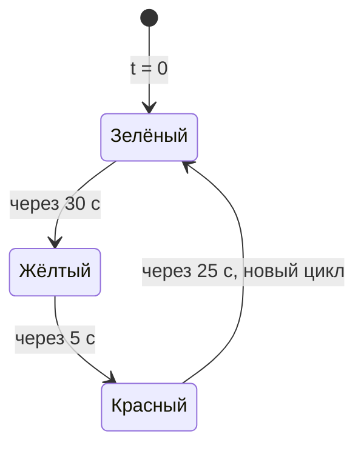

# 1. Симуляция одного светофора

**Задача.** Смоделировать один светофор, который сначала горит зелёным, затем жёлтым, затем красным и повторяет эту последовательность. Вывести журнал переключений с модельным временем.

**Условия:**

- в момент $t=0$ включается зелёный сигнал;
- зелёный горит 30 с, жёлтый — 5 с, красный — 25 с;
- после красного сразу включается зелёный и начинается следующий цикл; длительность полного цикла — 60 с;
- одновременно включён ровно один сигнал;
- моделирование длится 180 с; в этом упражнении рассматривается только переключение сигналов самого светофора.

Диаграмма состояний светофора:

**Что реализовать:**

1. Создать среду `simpy.Environment`.
2. Написать функцию-генератор `traffic_light(env, green_duration, yellow_duration, red_duration)` с повторяющимся циклом переключений.
3. При включении каждого сигнала сначала записывать его цвет и `env.now`, затем ожидать его длительность через `yield env.timeout(duration)`. Первая запись о зелёном должна появиться в момент $t=0$.
4. Зарегистрировать процесс через `env.process` и запустить моделирование вызовом `env.run(until=180)`.

**Проверка результата.** Журнал должен содержать следующие включения сигналов:

| Сигнал | Моменты включения, с |
| --- | --- |
| Зелёный | 0, 60, 120 |
| Жёлтый | 30, 90, 150 |
| Красный | 35, 95, 155 |

Всего получается девять записей за три цикла. Переключение в момент $t=180$ с не попадает в журнал: при числовом `until` SimPy останавливается до обработки событий на этой границе.

**Что освоить:** функцию-генератор, `yield`, `env.timeout`, `env.now`, `env.process`, повторение процесса и ограничение времени симуляции.

**Материалы:** [DataCamp — Introduction to the SimPy package](https://projector-video-pdf-converter.datacamp.com/30360/chapter2.pdf), 
Traffic lights: Building a SimPy model.

[К обзору этапа 1](../stage-1-simpy.md)
