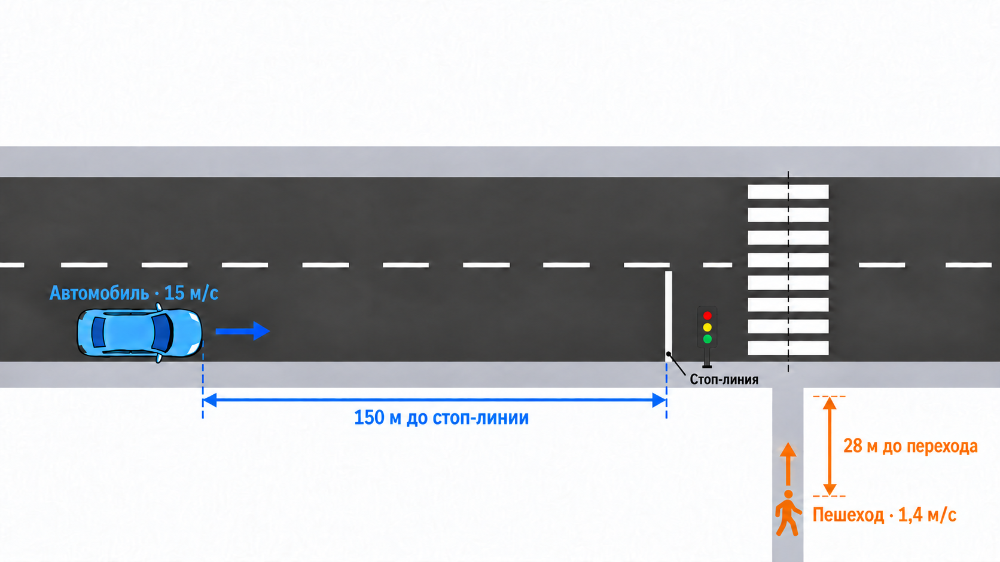
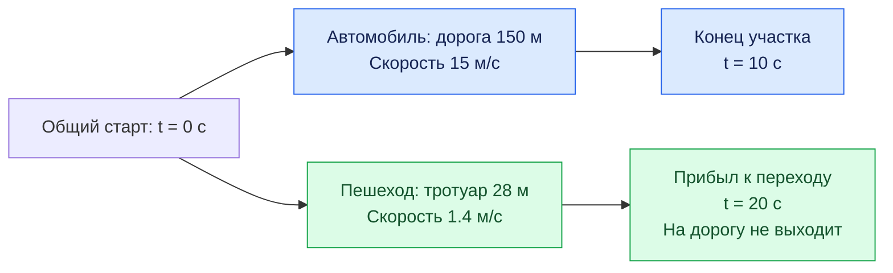

# 2. Автомобиль едет по дороге, пешеход подходит к переходу

**Задача.** Смоделировать одновременное движение одного автомобиля по участку дороги и одного пешехода по тротуару до перехода. Определить, когда каждый участник достигнет конца своего участка пути.

**Условия:**

- в момент $t=0$ автомобиль въезжает на участок дороги длиной $L_{\mathrm{car}}=150$ м со скоростью $v_{\mathrm{car}}=15$ м/с;
- одновременно пешеход начинает идти по тротуару к переходу: ему осталось $L_{\mathrm{ped}}=28$ м, его скорость $v_{\mathrm{ped}}=1.4$ м/с;
- оба движутся с постоянной скоростью и пока не взаимодействуют; пешеход завершает движение у края проезжей части, не выходя на дорогу.

Время движения каждого участника:

$$
t_{\mathrm{travel}}=\frac{L}{v}.
$$

**Схема движения.** Обе ветви запускаются одновременно в одной среде моделирования.

**Что реализовать:**

1. Создать одну среду `simpy.Environment` и два процесса: движение автомобиля и движение пешехода.
2. В каждом процессе записать время старта, дождаться `env.timeout(L / v)` и записать время прибытия.
3. Запустить оба процесса через `env.process` до начала выполнения симуляции.
4. Вывести журнал: время, тип участника, событие «начал движение» или «прибыл».

**Проверка результата.** Автомобиль завершает участок в момент $t=10$ с, пешеход приходит к переходу в момент $t=20$ с. Общее модельное время — 20 с: процессы идут одновременно, их длительности не складываются.

**Что освоить:** `env.now`, `yield`, `env.timeout`, `env.process` и совместное выполнение процессов в одной среде.

[К обзору этапа 1](../stage-1-simpy.md)
