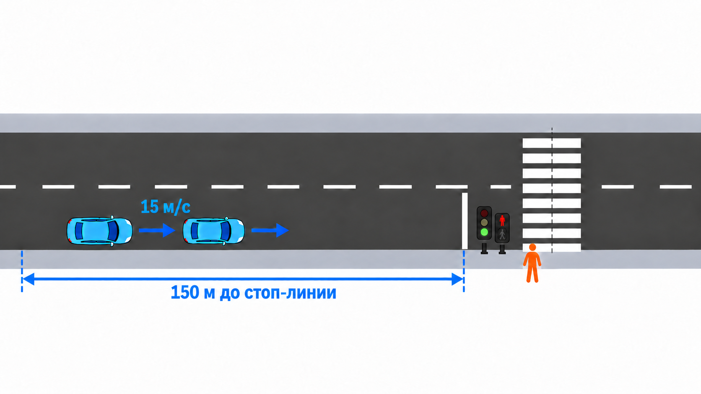
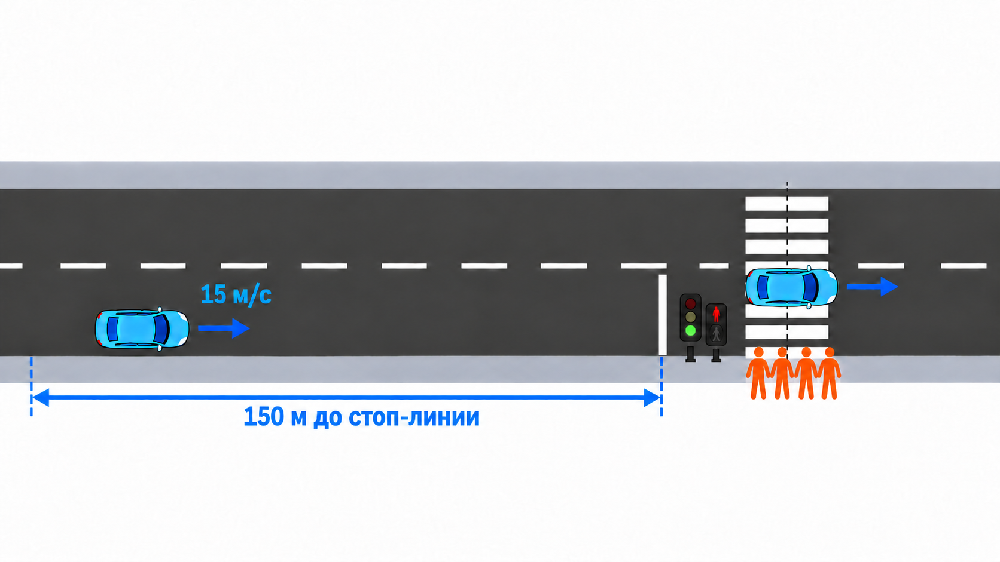
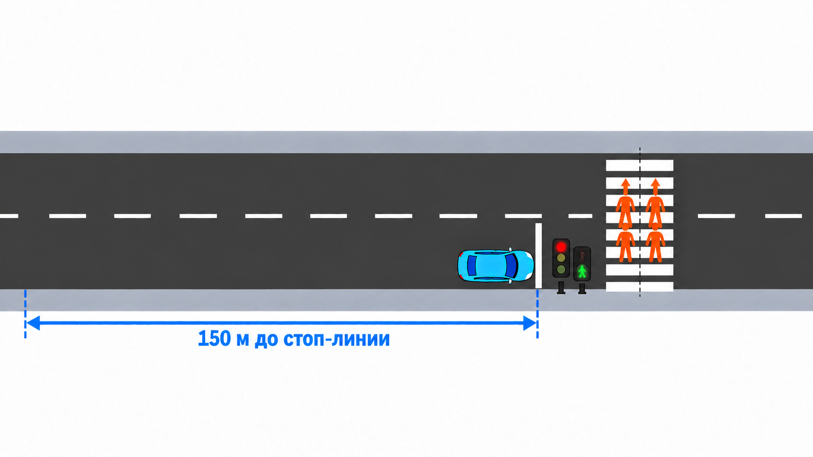
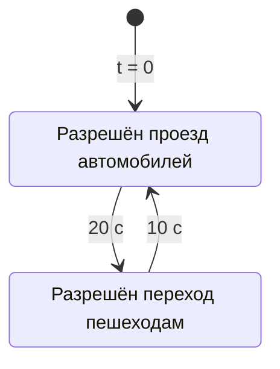
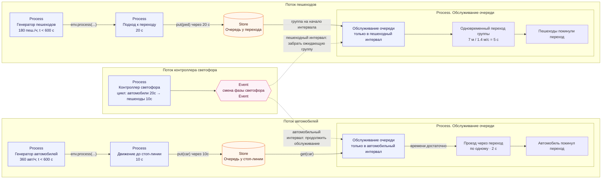

# 4. Очереди перед регулируемым пешеходным переходом

**Задача.** Добавить в конец автомобильного участка регулируемый пешеходный переход со светофором. Автомобили должны останавливаться перед ним, а пешеходы — ждать у края дороги. Организовать их движение так, чтобы разрешённые интервалы светофоров не пересекались.

#### Пример дорожной ситуации

Автомобили подъезжают к стоп-линии на зелёный сигнал. Пешеход ждёт у перехода, на пешеходном табло горит красный:

 У перехода собрались четыре пешехода и ждут на красный сигнал. Один автомобиль проезжает зебру на зелёный, другой подъезжает: 

Загорелся зеленый для пешеходов и красный для автомобилей. Все четыре пешехода переходят дорогу на зелёный сигнал. Автомобиль стоит перед стоп-линией: 

#### Условия

- использовать потоки из [упражнения 3](exercise-03.md);
- автомобиль после 10с движения присоединяется к очереди перед стоп-линией, пешеход сразу при появлении — к очереди у перехода;
- с момента $t=0$ повторяется цикл светофора длительностью 30с: первые 20с разрешён проезд автомобилей, следующие 10с отведены пешеходам;
- проезд одного автомобиля через переход занимает 2с; автомобили обслуживаются по одному в порядке прибытия;
- ширина перехода — 7м, скорость пешехода — 1.4м/с, поэтому переход занимает 5с;
- в начале пешеходного интервала все уже ожидающие пешеходы начинают переход одновременно; пришедшие позже ждут следующего цикла;
- автомобиль может начать проезд только тогда, когда успеет завершить его до конца автомобильного интервала. Завершить проезд ровно на границе интервала допустимо.

При фиксированном заданном потоке автомобилей построить график зависимости средней скорости проезда всего участка
автомобилем в зависимости от плотности потока пешеходов. Сравнить с графиком из предыдущего упражнения.

В этом упражнении используется упрощённый цикл светофора из двух разрешённых интервалов. Жёлтые фазы в модели движения, защитные интервалы и полноценная логика контроллера светофора появятся на этапе 2 проекта.

**Диаграмма состояний светофора:**

**Что реализовать:**

1. Создать две очереди `simpy.Store`: для автомобилей и пешеходов, достигших перехода. 
2. Написать процесс контроллера светофора, который хранит текущий разрешённый интервал и сообщает о его смене через `Event`.
3. Написать процесс обслуживания автомобильной очереди: дождаться разрешения, пропускать автомобили последовательно.
4. Написать процесс обслуживания пешеходной очереди: в начале пешеходного интервала выбрать ожидающую группу и смоделировать её переход.
5. Записывать для каждого участника время начала и завершения проезда или перехода.
6. После отключения генераторов продолжать обслуживание до выхода всех участников, затем завершать симуляцию.
7. Построить требуемый график для разных интенсивностей потока пешеходов

## Модель автомобиля и пешехода

Автомобили и пешеходы удобно моделировать в виде двух классов - Vehicle и Pedestrian с общим предком Participant. 
Participant содержит id, скорость передвижения и общие мониторинговые данные (времена прохождения различных этапов):

- `id`;
- `velocity`;
- `created_at`;
- `finished_at`.
- `queue_entered_at`;
- `queue_left_at`;

Минимальное состояние `Vehicle` который наследует данные `Participant`:

- `current_segment`;

Жизненный цикл `Vehicle`:

1. Появиться на входе сети.
2. Занять место на `RoadSegment`.
3. Провести на участке $t_{\mathrm{free}}$.
5. Встать в очередь соответствующего движения.
6. Дождаться разрешающей фазы светофора.
7. Дождаться свободного места на выездном участке.
8. Проехать через перекресток.
8. Занять следующий въездной участок следующего сегмента.
9. Только после этого освободить место на предыдущем участке.

Жизненный цикл `Pedestrian`:

1. Появиться на подходе к перекрестку.
2. Встать в очередь перед перекрестком.
3. Дождаться разрешающей фазы светофора.
4. Перейти переход
5. Покинуть перекресток

**Потоки данных и событий:**

**Проверка результата.** Сначала отключить случайные генераторы и задать прибытия непосредственно к переходу: три автомобиля в момент $t=0$ и два пешехода в момент $t=1$ с. Автомобили проходят в интервалах 0–2, 2–4 и 4–6 с; пешеходы ждут до $t=20$ с и переходят в интервале 20–25 с. Затем включить случайные потоки и проверить сохранение FIFO для автомобилей, отсутствие движения на запрещённом интервале и отсутствие одновременного нахождения автомобилей и пешеходов на переходе.

**Что освоить:** `Store`, FIFO, ожидание событий, взаимодействие процессов и отделение движения от ожидания в очереди.

**Материалы:** [DataCamp — Deterministic events and processes](https://projector-video-pdf-converter.datacamp.com/30360/chapter3.pdf).

[К обзору этапа 1](../stage-1-simpy.md)
