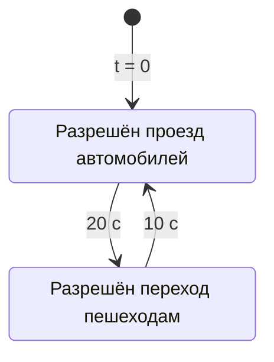
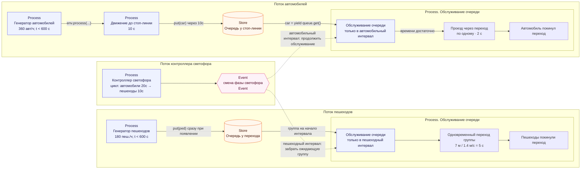

# 4. Очереди перед регулируемым пешеходным переходом

**Задача.** Добавить в конец автомобильного участка регулируемый пешеходный переход со светофором. Автомобили должны останавливаться перед ним, а пешеходы — ждать у края дороги. Организовать их движение так, чтобы разрешённые интервалы светофоров не пересекались.

#### Пример дорожной ситуации

Автомобили подъезжают к стоп-линии на зелёный сигнал. Пешеход ждёт у перехода, на пешеходном табло горит красный:

 У перехода собрались четыре пешехода и ждут на красный сигнал. Один автомобиль проезжает зебру на зелёный, другой подъезжает: 

Загорелся зеленый для пешеходов и красный для автомобилей. Все четыре пешехода переходят дорогу на зелёный сигнал. Автомобиль стоит перед стоп-линией: 

#### Условия

- использовать интенсивности и случайную генерацию потоков из [упражнения 3](exercise-03.md). 
- автомобиль после 10с движения присоединяется к очереди перед стоп-линией, пешеход сразу при появлении — к очереди у перехода;
- начиная с этого упражнения пешеход появляется непосредственно у перехода: путь подхода равен 0 м;
- с момента $t=0$ повторяется цикл светофора длительностью 30с: первые 20с разрешён проезд автомобилей, следующие 10с отведены пешеходам;
- проезд одного автомобиля через переход занимает 2с; автомобили обслуживаются по одному в порядке прибытия;
- ширина перехода — 7м, скорость пешехода — 1.4м/с, поэтому переход занимает 5с;
- в начале пешеходного интервала ожидающая группа начинает переход одновременно. В группу пешеходов входят только прибывшие строго раньше начала фазы. Прибывшие ровно в момент её начала или позже ждут следующей пешеходной фазы;
- автомобиль может начать проезд только тогда, когда успеет завершить его до конца автомобильного интервала. Завершить проезд ровно на границе интервала допустимо.

Считать фазы настроенными так, что при разрешённой скорости автомобиль гарантированно успевает полностью проехать перекрёсток за зелёную фазу. При допуске конкретного автомобиля проверять именно оставшееся время зелёного: оно должно быть не меньше времени проезда.

При фиксированном заданном потоке автомобилей построить график зависимости среднего времени проезда всего участка автомобилем от интенсивности потока пешеходов.

Время проезда автомобиля считать от его появления на входе участка до полного завершения проезда перехода, включая движение до стоп-линии и ожидание в очереди. Среднее время проезда — среднее арифметическое этих времён по всем созданным автомобилям после их выхода из модели; единица измерения — секунды.

В этом упражнении используется упрощённый цикл светофора из двух разрешённых интервалов. Жёлтые фазы в модели движения, защитные интервалы и полноценная логика контроллера светофора появятся на этапе 2 проекта.

**Диаграмма состояний светофора:**

**Что реализовать:**

1. Создать две очереди `simpy.Store`: для автомобилей и пешеходов, достигших перехода. 
2. Написать процесс контроллера светофора, который хранит текущий разрешённый интервал и сообщает о его смене через `Event`.
3. Написать процесс обслуживания автомобильной очереди: дождаться разрешения, пропускать автомобили последовательно.
4. Написать процесс обслуживания пешеходной очереди: в начале пешеходного интервала выбрать ожидающую группу и смоделировать её переход.
5. Записывать для каждого участника время начала и завершения проезда или перехода.
6. После отключения генераторов продолжать обслуживание до выхода всех участников, затем завершать симуляцию.
7. Построить график среднего времени проезда автомобилей в секундах для разных интенсивностей потока пешеходов.

## Модель автомобиля и пешехода

Автомобили и пешеходы удобно моделировать в виде двух классов - Vehicle и Pedestrian с общим предком Participant. 
Participant содержит id, скорость передвижения и общие мониторинговые данные (времена прохождения различных этапов):

- `id`;
- `velocity`;
- `created_at`;
- `finished_at`.
- `queue_entered_at`;
- `queue_left_at`;

Жизненный цикл `Vehicle`:

1. Появиться на входе участка и записать `created_at`.
2. Доехать до стоп-линии за 10с.
3. Встать в FIFO-очередь перед переходом и записать `queue_entered_at`.
4. Дождаться разрешённого автомобильного интервала и своей очереди. До конца интервала должно оставаться не менее 2с.
5. Начать проезд, записать `queue_left_at` и проехать переход за 2с.
6. Покинуть модель и записать `finished_at`.

Жизненный цикл `Pedestrian`:

1. Появиться непосредственно у перехода.
2. Сразу встать в очередь у перехода.
3. Дождаться разрешающей фазы светофора.
4. Перейти переход.
5. Покинуть перекресток.

**Потоки данных и событий:**

### Проверка результата.

1. **Фиксированный поток**. Сначала отключить случайные генераторы и задать прибытия непосредственно к переходу: три автомобиля в момент $t=0$ и два пешехода в момент $t=1$ с. Автомобили проходят в интервалах 0–2, 2–4 и 4–6 с; пешеходы ждут до $t=20$ с и переходят в интервале 20–25 с.

2. **Случайный поток**. Включить случайные потоки и проверить сохранение FIFO для автомобилей, отсутствие движения на запрещённом интервале и отсутствие одновременного нахождения автомобилей и пешеходов на переходе.

3. **Все автомобили, успевающие проехать на зелёный, проезжают.** При непустой очереди, свободном переходе и достаточном остатке зелёного следующий автомобиль начинает движение сразу. Это относится и к автомобилям, прибывшим во время зелёной фазы. Не должно быть простоев, из-за которых автомобиль, способный завершить проезд в текущей фазе, остаётся ждать следующую. Для проверки поставить 12 автомобилей у стоп-линии к началу зелёного в момент $t=0$: при длительности зелёного 20с и времени проезда 2с первые 10 автомобилей должны проехать подряд в интервалах 0–2, 2–4, …, 18–20с; в очереди остаются ровно два автомобиля. При очереди из 10 автомобилей к концу этой фазы очередь должна быть пустой.

**Что освоить:** `Store`, FIFO, ожидание событий, взаимодействие процессов и отделение движения от ожидания в очереди.

**Материалы:** [DataCamp — Deterministic events and processes](https://projector-video-pdf-converter.datacamp.com/30360/chapter3.pdf).

[К обзору этапа 1](../stage-1-simpy.md)
