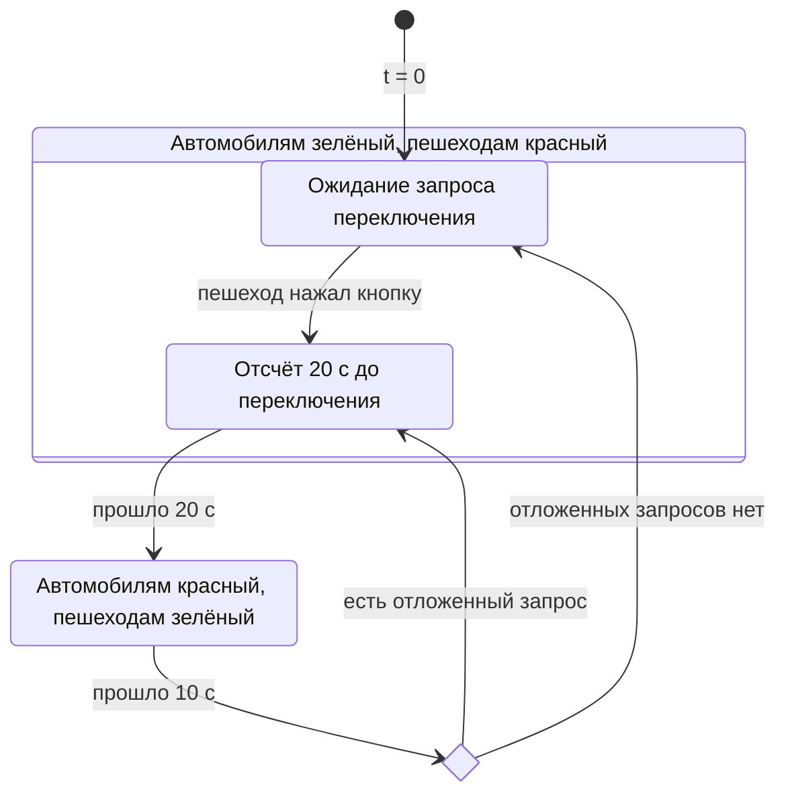

# 4а. Светофор с кнопкой вызова пешеходной фазы

**Задача.** Исходные данные такие же как в [упражнении 4](exercise-04.md). Фазовый светофор заменяется светофором, который реагирует на кнопку появления пешехода. Пока запросов нет, светофор остаётся зелёным для автомобилей и красным для пешеходов. Смена фаз запускается по запросу подошедшего пешехода.

При фиксированном заданном потоке автомобилей построить график зависимости среднего времени проезда всего участка автомобилем от интенсивности потока пешеходов. Время проезда и его среднее считать по определению из [упражнения 4](exercise-04.md): от появления автомобиля на входе участка до полного завершения проезда перехода, включая движение до стоп-линии и ожидание в очереди. Сравнить с графиком из предыдущего упражнения.

**Условия:**

- сохранить потоки, период генерации и две очереди из [упражнения 4](exercise-04.md):
  - автомобиль за 10с доезжает до стоп-линии, затем ждёт в FIFO-очереди и проезжает переход за 2с; 
  - пешеход появляется непосредственно у перехода и сразу встаёт в пешеходную очередь;
- в момент $t=0$ включён зелёный для автомобилей; без пешеходов он может гореть сколько угодно долго;
- первый ожидающий пешеход нажимает кнопку. Для этого упражнения принять задержку переключения 20с **от момента нажатия**, а не от начала автомобильной фазы.
- следующие пешеходы присоединяются к ожидающей группе: их нажатия не перезапускают таймер и не создают дополнительные циклы;
- через 20с после первого запроса включается красный для автомобилей и зелёный для пешеходов на 10с. В начале этой фазы ожидающая группа одновременно начинает переход длительностью 5с. В группу пешеходов входят только прибывшие строго раньше начала фазы. Запрос этой группы считается обслуженным;
- пешеходы, появившиеся у перехода ровно в момент начала пешеходной фазы или позже, ждут следующей фазы и оставляют запрос на неё. Он сохраняется до возвращения зелёного автомобилям; с этого момента начинается новый отсчёт 20с;
- после 10с пешеходной фазы снова включается зелёный для автомобилей. Если отложенных запросов нет, контроллер ждёт первого нового пешехода без автоматического переключения;

**Диаграмма состояний светофора:**

**Что реализовать:**

1. Сохранить очереди `simpy.Store` и процессы обслуживания из [упражнения 4](exercise-04.md). 
2. При постановке пешехода в очередь передавать запрос контроллеру. Представить нажатие кнопки через `simpy.Event`. 
Контроллер должен ждать событие через `yield`, без периодической проверки кнопки через короткие `timeout`.
3. Хранить состояние запроса и ожидающую группу. Вызывать `event.succeed()` только для ещё не сработавшего события.
Создавать новое событие для следующего запроса, сохраняя запросы, поступившие во время пешеходной фазы.
4. Логика контролера и переключение фаз начинает зависеть от запроса на переключение от пешехода.
5. В начале пешеходной фазы забирать ожидающую группу из очереди и моделировать её переход за 5с.
6. Построить график среднего времени проезда автомобилей в секундах для разных интенсивностей потока пешеходов.

**Проверка результата.** Сначала вместо случайного потока задать появления пешеходов в моменты 40, 45 и 65 с:

| Время, с | Ожидаемое событие |
| --- | --- |
| 0–40 | Автомобилям зелёный; без запроса фаза не меняется |
| 40 | Первый пешеход нажимает кнопку; начинается отсчёт 20 с |
| 45 | Второй пешеход присоединяется; момент переключения остаётся 60 с |
| 60 | Начинается пешеходная фаза; первые два пешехода переходят в интервале 60–65 с |
| 65 | Третий пешеход оставляет запрос на следующую пешеходную фазу |
| 70 | Автомобилям включается зелёный; сохранённый запрос запускает отсчёт 20 с |
| 90 | Начинается следующая пешеходная фаза; третий пешеход переходит в интервале 90–95 с |
| 100 | Автомобилям включается зелёный; без новых запросов переключений больше нет |

Для проверки автомобильной очереди задать прибытия непосредственно к стоп-линии в моменты 57с и 59с.
Первый автомобиль проезжает в интервале 57–59с; второму не хватает времени до переключения в 60с,
поэтому он ждёт и проезжает в интервале 70–72с. Проверить отсутствие пересечения с движением пешеходов в интервалах 60–65 и 90–95 с.

Отдельно проверить запуск без пешеходов: на всём интервале моделирования автомобилям горит зелёный. Затем вернуть случайные потоки [упражнения 4](exercise-04.md) с фиксированным seed: каждый участник должен покинуть модель, FIFO автомобилей должен сохраняться, а повторные нажатия ожидающей группы не должны продлевать ожидание. 

Число вышедших участников должно совпадать с числом созданных отдельно для автомобилей и пешеходов.

**Что освоить:** ожидание внешнего события через `Event`, управление фазами по запросу, объединение повторных запросов и сохранение запроса между фазами, обслуживание очередей при переменной длительности зелёного и согласование переключения с освобождением перехода.

[К обзору этапа 1](../stage-1-simpy.md)
