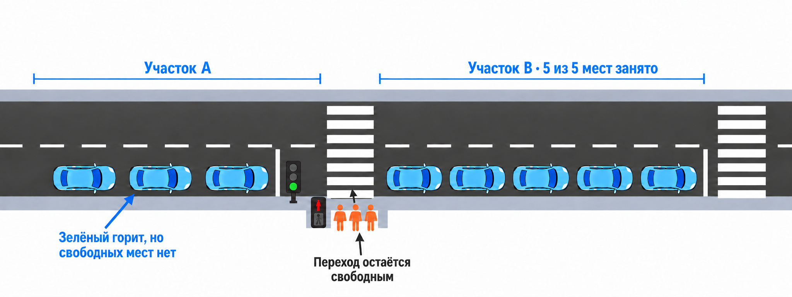

# 6. Затор за переходом блокирует проезд автомобилей

**Задача.** Продолжить модель [упражнения 4](exercise-04.md): добавить после перехода второй дорожный участок B, на котором помещается не более пяти автомобилей. Показать, как заполнение B останавливает выпуск автомобилей с участка A перед переходом, даже когда автомобилям разрешён проезд.


<p align="center">

</p>

**Условия:**

- пешеход появляется непосредственно у перехода и сразу встаёт в очередь; ожидание сигнала и переход сохраняются по правилам упражнения 4;
- участок A — дорога перед переходом; для отдельного изучения влияния B считать вместимость A неограниченной;
- участок B вмещает пять автомобилей, включая зарезервированные места для уже начавших проезд через переход;
- после полного въезда на B автомобиль едет по нему 10с и покидает сеть;
- автомобиль может начать проезд через переход только при разрешённом автомобильном интервале светофора и наличии места на B. Место на B резервируется перед началом проезда. Если автомобиль ожидал место и за это время разрешённый интервал закончился, нужно повторно проверить разрешение и не занимать переход в ожидании;
- пешеходы продолжают обслуживаться по правилам [упражнения 4](exercise-04.md): автомобиль, ожидающий место на B, стоит перед переходом и не перекрывает его.
- В группу пешеходов входят только прибывшие строго раньше начала фазы. Прибывшие ровно в момент её начала или позже ждут следующей пешеходной фазы.

**Что реализовать:**

1. Представить свободные места на B через `simpy.Container` с `capacity=5` и `init=5`.
2. До начала проезда резервировать одно место на B. После завершения проезда переносить автомобиль с A на B, затем моделировать его движение по B.
3. При выходе автомобиля из B возвращать одно свободное место.
4. Выполнить два запуска с одинаковыми появлениями участников: со свободным выходом из B и с временно закрытым выходом в интервале 0–60 с. При закрытом выходе автомобили закончившие движение по B остаются на нём и продолжают занимать места.

## Модель автомобиля и его жизненный цикл

Участки A и B представить объектами `RoadSegment`. Автомобиль `Vehicle` наследует данные `Participant` из [упражнения 4](exercise-04.md) и дополнительно хранит `current_segment` — ссылку на текущий участок. Вместимость A остаётся неограниченной: нахождение автомобиля на нём можно учитывать без контейнера свободных мест.

Жизненный цикл `Vehicle`:

1. Появиться на входе сети, записать `created_at` и въехать на A, установив `current_segment = A`.
2. Доехать по A до стоп-линии за 10с.
3. Встать в FIFO-очередь перед переходом. Во время ожидания автомобиль остаётся на A.
4. Дождаться своей очереди и разрешённого автомобильного интервала с остатком времени не менее 2с.
5. Зарезервировать одно место на B до начала проезда перехода. Если B заполнен, ждать перед стоп-линией. После любого ожидания повторно проверять сигнал и остаток времени; при потере разрешения возвращать полученный резерв или отменять незавершённую заявку на него.
6. Проехать переход за 2с. До полного въезда на B автомобиль ещё находится на A и уже имеет резерв на B.
7. После полного въезда на B установить `current_segment = B` и освободить A от автомобиля. Резерв на B становится занятым местом без изменения числа свободных мест.
8. Проехать по B за 10с.
9. Если выход из B временно закрыт, дождаться его открытия, продолжая занимать место на B.
10. Покинуть сеть, вернуть свободное место на B, установить `current_segment = None` и записать `finished_at`.

#### Как определить capacity из длины дороги

Например, длина участка:
$$L=150 м$$
Допустим, в стоящей очереди на одну машину вместе с интервалом принимаем:
$$l_{vehicle}=7.5 м$$
Для одной полосы:
$$C=floor(\frac{150}{7.5})=20$$
Для двух полос грубо:
$$C=2\times20=40$$
Т.е. для capacity сегмента можно написать:
```py
capacity = math.floor(length * lanes / effective_vehicle_length)
# Для length=150, lanes=2 и effective_vehicle_length=7.5 результат — 40.
```
В реальной калибровке `effective_vehicle_length` можно подправить.

**Проверка результата.** Для наглядного отдельного теста поставить восемь автомобилей в очередь на A в момент $t=0$, оставить B пустым и закрыть его выход до $t=60$ с. Первые пять автомобилей займут или зарезервируют все места на B; остальные три останутся перед переходом. Число занятых и зарезервированных мест никогда не превышает пяти. В пешеходные интервалы переход остаётся доступен пешеходам. После открытия выхода из B автомобили снова получают возможность проезда при разрешающем сигнале.

Так проявляется начало spillback: заполненный участок B блокирует выпуск с A.

**Что освоить:** `Container`, резервирование и освобождение вместимости, повторная проверка условий после ожидания и влияние downstream-затора на очередь перед переходом.

[К обзору этапа 1](../stage-1-simpy.md)
