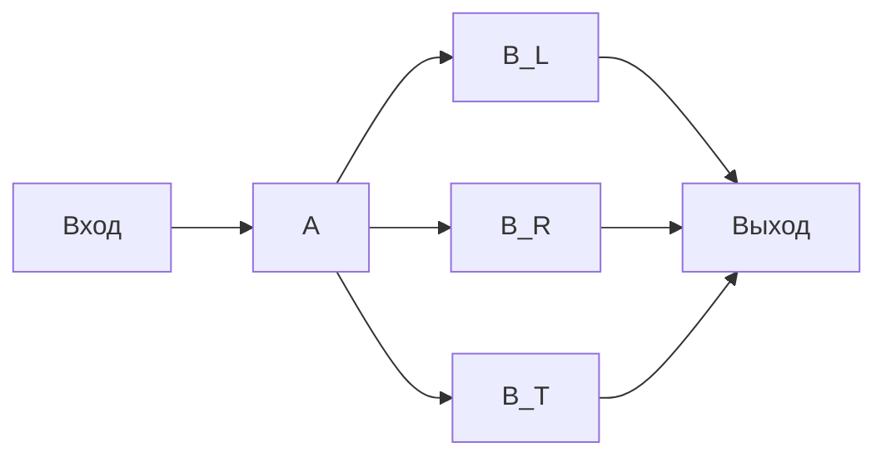
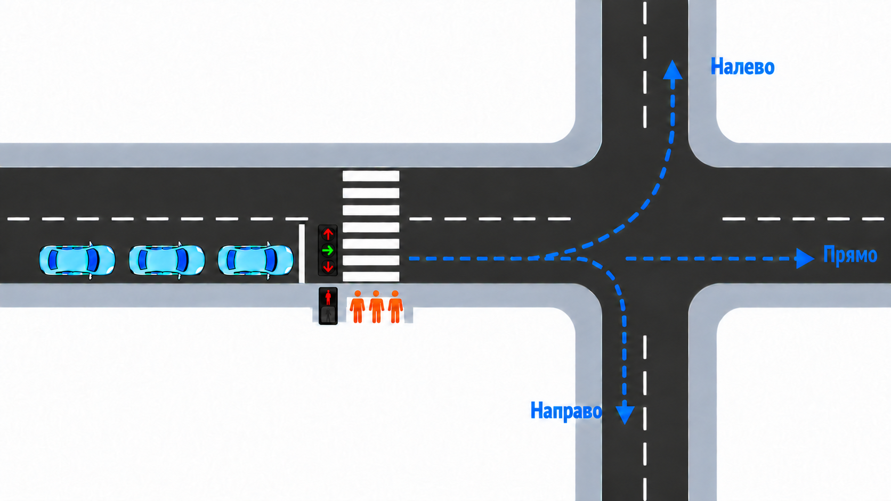
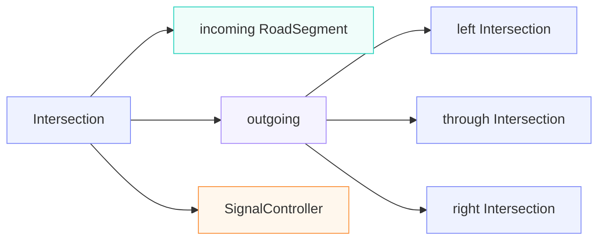

# 7. Три направления движения и согласованные светофоры

**Задача.** Продолжить модель [упражнения 6](exercise-06.md): входящий поток с участка A разделяется на автомобили, едущие прямо, налево и направо. Каждое направление регулируется своим светофором и ведёт к отдельному следующему перекрёстку. Согласовать сигналы и учитывать ограниченную вместимость принимающих участков.

Поток на участке A распадается на три, каждый автомобиль может повернуть налево, проехать прямо, повернуть направо.

Показана фаза движения прямо и согласованные сигналы:

**Условия:**

- параметры появления автомобилей, движения по A и подхода пешеходов взять из [упражнения 6](exercise-06.md). Вместимость A в базовом варианте остаётся неограниченной;
- при появлении каждый автомобиль один раз выбирает направление: прямо с вероятностью 0.5, налево — 0.3, направо — 0.2. Сохранить выбор в объекте автомобиля; при заторе направление не менять;
- после движения по A автомобиль попадает в одну из трёх FIFO-очередей перед стоп-линией. Они представляют отдельные полосы: ожидающий левый поворот не перекрывает движение прямо и направо;
- проезд центрального перекрёстка по любому направлению занимает 2с. По каждому направлению автомобили обслуживаются по одному;
- три автомобильных светофора центрального перекрёстка управляются одним контроллером по общему 60-секундному циклу. В каждый момент зелёный разрешён только одному автомобильному направлению либо пешеходам; остальные сигналы красные;
- пешеходы начинают переход группой в начале своего интервала и пересекают дорогу за 5с по правилам [упражнения 4](exercise-04.md). В группу пешеходов входят только прибывшие строго раньше начала фазы. Прибывшие ровно в момент её начала или позже ждут следующей пешеходной фазы. Цикл из предыдущих упражнений заменить следующим:

| Время внутри цикла, с | Разрешённое движение |
| --- | --- |
| 0–24 | Автомобили прямо |
| 24–36 | Автомобили налево |
| 36–48 | Автомобили направо |
| 48–60 | Только пешеходы |

После центрального перекрёстка каждый автомобиль едет 10с по выбранному участку до следующей стоп-линии. Каждый принимающий перекрёсток моделируется своим подъездным участком, FIFO-очередью и светофором. Проезд его стоп-линии занимает 2с, после чего автомобиль покидает модель.

| Направление | Принимающий перекрёсток | Вместимость подхода, автомобилей | Зелёный на принимающем перекрёстке, с внутри 60-секундного цикла |
| --- | --- | --- | --- |
| Прямо | B_T | 5 | 12–36 |
| Налево | B_L | 3 | 36–48 |
| Направо | B_R | 2 | 48–60 |

Все контроллеры используют общее модельное время и начало цикла $t=0$; интервалы повторяются каждые 60 с. Зелёный у принимающих перекрёстков сдвинут на 12с относительно соответствующего направления в центре: 2с проезда и 10с движения до следующей стоп-линии. Вне указанного интервала соответствующий сигнал красный. Интервалы включают начало и не включают конец; завершить проезд ровно на границе разрешено. Это учебная схема без отдельных жёлтых фаз.

Вместимость каждого принимающего подхода учитывает занятые и зарезервированные места: от резервирования перед выездом с A до полного завершения проезда следующего перекрёстка. Зелёный в центре разрешает старт только при свободном месте на выбранном подходе и достаточном времени для завершения текущего проезда. Если мест нет, автомобиль остаётся перед центральной стоп-линией; красный на следующем перекрёстке сам по себе не запрещает въезд на его подход, пока там есть место.

**Что реализовать:**

1. Создать три очереди `simpy.Store` для направлений и три `simpy.Container` для свободных мест на принимающих подходах. Для каждого принимающего перекрёстка создать отдельную очередь и процесс обслуживания.
2. Написать общий контроллер трёх центральных сигналов и пешеходного интервала, а также контроллеры принимающих перекрёстков с указанными расписаниями. Сообщать о сменах сигналов через `Event`.
3. Для первого автомобиля каждой очереди проверять свой зелёный, место только на выбранном принимающем подходе. Резервировать место перед проездом; после любого ожидания заново проверять условия. Если разрешение потеряно, вернуть уже полученное резервирование или отменить незавершённую заявку на него.
4. После проезда центрального перекрёстка и 10 с движения поставить автомобиль в очередь выбранного принимающего перекрёстка. Выпустить его только на местный зелёный, если до конца интервала хватает 2 с; затем освободить место.
5. Записывать направление, времена ожидания у обеих стоп-линий, задержку из-за заполнения принимающего подхода, его занятость с учётом резервов и число завершивших путь автомобилей по каждому направлению. Использовать фиксированный seed для выбора направлений и входного потока.
6. После остановки генераторов дождаться выхода всех автомобилей и пешеходов, включая ожидающих на принимающих перекрёстках, и завершить симуляцию.

## Граф моделей перекрестков

Все перекрестки можно представить в виде графа объектов Intersection:

Для каждого перекрестка задается:
* длина и предельная скорость подъездного сегмента - incoming RoadSegment
* контейнер, который регулирует вместимость подъездного сегмента
* длина и предельная скорость пересечения перекрестка автомобилем
* очередь ожидания на стоп-линии
* объект, который описывает времена переключений контроллера светофора и запускает процессы переключения фаз - SignalController
* ссылки на Intersection следующего перекрестка 

**Проверка результата:**

1. Для проверки расписаний задать по одному автомобилю каждого направления непосредственно перед центральной стоп-линией в момент $t=0$, оставив принимающие участки пустыми:

| Направление | Проезд центрального перекрёстка, с | Прибытие к следующей стоп-линии, с | Проезд принимающего перекрёстка, с |
| --- | --- | --- | --- |
| Прямо | 0–2 | 12 | 12–14 |
| Налево | 24–26 | 36 | 36–38 |
| Направо | 36–38 | 48 | 48–50 |

2. Повторить запуск, заранее заняв все три места на подходе B_L автомобилями у его стоп-линии и запретив их выпуск до $t=120$ с. Левый поворот должен ждать перед центральным перекрёстком даже на свой зелёный. Автомобили прямо и направо проходят по расписанию из таблицы. После снятия запрета B_L обслуживается по своему светофору; левый поворот возобновляется, когда освободится место и наступит следующий разрешённый интервал в центре.
3. Включить случайные потоки. Проверить FIFO внутри каждого направления, соблюдение вместимости 5/3/2 с учётом резервов, отсутствие одновременного разрешения конфликтующих движений и сохранение числа автомобилей: после полного завершения модели число вышедших равно числу созданных. В тесте с предзаполненным B_L отдельно учесть три исходных автомобиля. Частоты выбора направлений при большом числе автомобилей должны приближаться к 0.5/0.3/0.2.

**Что освоить:** разделение потока по маршрутам, отдельные очереди направлений, согласование светофоров, взаимодействие нескольких перекрёстков и блокирование конкретного направления из-за ограниченной вместимости следующего участка.

[К обзору этапа 1](../stage-1-simpy.md)
