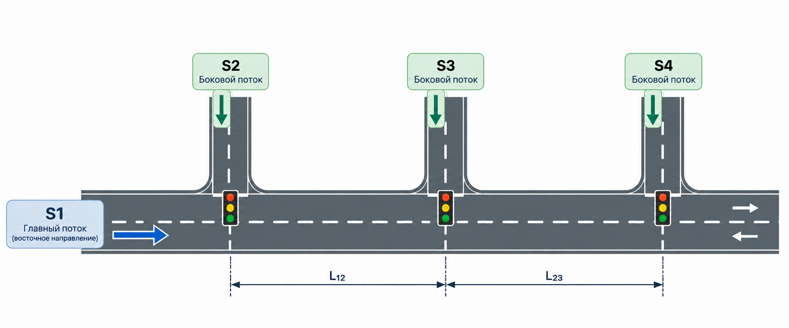
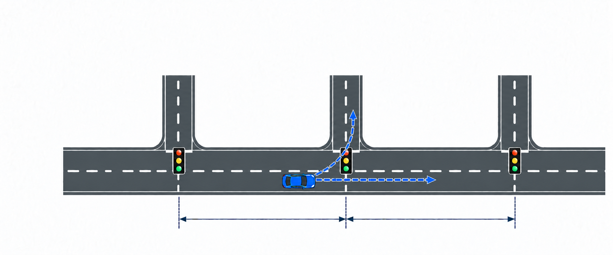
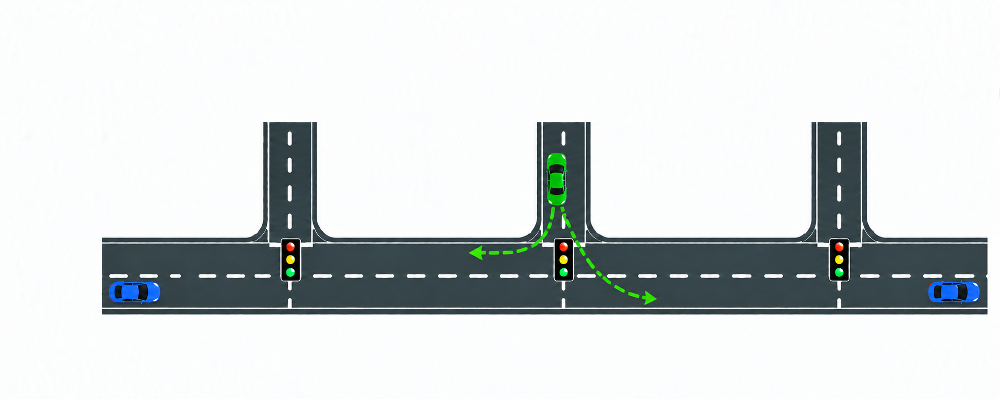

# 8. Модель дорожной сети с четырьмя входящими потоками

**Задача.** Построить в SimPy модель дорог и трёх перекрёстков по приведённой схеме. Главный поток S1 движется на восток через I1 к I2, где автомобиль может продолжить движение к I3 или свернуть налево на боковую дорогу. Боковые потоки S2, S3 и S4 входят на I1, I2 и I3 соответственно. Интенсивности всех четырёх входящих потоков считать известными входными параметрами.

Пример: автомобиль из S1 едет по главной дороге через I1. На I2 он либо проезжает прямо на въездной сегмент I3, либо поворачивает налево и покидает главную дорогу по северному ответвлению.

Пример: автомобили из S3 появляется на боковом подходе I2 и выбирает одну из двух ветвей: влево по рисунку, к I1, или вправо по рисунку, к I3. Во втором случае он вливается в восточный поток главной дороги и занимает место на въездном сегменте I3, увеличивая поток на этом сегменте.

**Условия:**

- обозначения S1–S4 трактовать как интенсивности появления автомобилей в автомобилях в час. Это входные данные, а не величины, которые нужно подбирать или оценивать.
- создать четыре независимых генератора. Для потока Si интервалы между появлениями имеют экспоненциальное распределение с параметром `Si / 3600`; при `Si = 0` соответствующий генератор не создаёт автомобили. Перед первым появлением также выдерживать случайный интервал;
- задать вероятность `p1_left` поворота автомобиля S1 налево на I2 и вероятность `p3_to_I3` выбора автомобилем S3 направления к I3. Остальные вероятности равны `1 - p1_left` и `1 - p3_to_I3`. Выбирать маршрут один раз при создании автомобиля и не менять его при заторе;
- каждый входной подход и каждый участок между перекрёстками представить отдельным `RoadSegment` с длиной, скоростью и вместимостью. Для каждого перекрёстка задать длину и скорость проезда отдельно для главного и бокового направлений. Время движения вычислять как отношение длины к скорости;
- L12 и L23 на рисунке — расстояния между перекрёстками или заданные длины входящих сегментов для перекрестков I2 и I3.
- численные значения длин, скоростей, вместимостей и длительностей сигналов на схеме не указаны. Задать их в конфигурации эксперимента и привести рядом с результатами
- у каждого входного подхода своя FIFO-очередь. На I1 это восточный, западный и боковой подходы; на I2 и I3 — восточный и боковой. Повороты из одного подхода используют общую очередь. После слияния автомобили попадают на общий следующий сегмент в порядке фактического выезда с перекрёстка;
- каждый перекрёсток имеет собственный `SignalController`. На I2 и I3 он чередует две фазы: зелёный восточному подходу и зелёный боковому подходу. На I1 последовательно обслуживаются восточный, боковой и западный подходы. В каждой фазе зелёный только у одного подхода, у остальных красный. Продолжительности и начальное состояние задаются отдельно для I1, I2 и I3; контроллеры работают независимо, без согласования между перекрёстками. Жёлтые фазы в этом учебном варианте не моделировать;
- через каждый перекрёсток одновременно проезжает не более одного автомобиля. Начать проезд можно только при разрешающем местном сигнале, достаточном времени до конца фазы и наличии места на принимающем участке.
- применять резервирование вместимости из предыдущих упражнений. Автомобиль резервирует место на следующем участке до начала проезда и освобождает исходный участок после полного выезда. Занятость включает резервы, движение, очередь и проезд выходного перекрёстка; заблокированный автомобиль остаётся перед стоп-линией. После любого ожидания повторно проверять условия допуска;
- если входной подход заполнен, созданный автомобиль ждёт во внешней FIFO-очереди своего источника. Генератор продолжает создавать автомобили с заданной интенсивностью: затор не должен искусственно уменьшать входящий спрос;
- все генераторы работают в интервале `0 <= t < T`, где T — заданная длительность поступления автомобилей. После их остановки дождаться выхода всех автомобилей, включая внешние очереди. Выходы после I3, западного проезда I1 и северного поворота I2 считать свободными.

**Что реализовать:**

1. Собрать граф объектов `RoadSegment`, `Intersection` и `SignalController` по схеме. Геометрию, вместимости, скорости, параметры светофоров, вероятности маршрутов, S1–S4 и T хранить в конфигурации, отдельно от логики процессов.
2. Создать независимые генераторы с отдельными фиксированными seed и отдельный генератор случайных чисел для выбора маршрутов. Сохранять у автомобиля источник, маршрут и времена появления, допуска в сеть, прибытия к стоп-линиям и выхода из модели.
3. Реализовать движение, очереди, управление сигналами, слияние потоков и резервирование следующего сегмента. При недостатке вместимости затор должен распространяться от I3 к I2 и I1, а затем во внешние очереди.
4. Для каждого источника измерять полное время в системе от появления до выхода.
6. При неизменных S1–S4 выполнить два эксперимента с разными длительностями фаз одного светофора. Использовать одинаковые последовательности появлений автомобилей и одинаковые выбранные маршруты; сравнить задержки главного и одного бокового потока. Расписания двух остальных светофоров должны остаться прежними.

**Проверка результата:**

1. Отключить случайные генераторы и последовательно, в отдельных запусках, пропустить по одному автомобилю по каждому варианту маршрута из таблицы. Проверить маршрут, времена свободного движения и ожидание только на посещаемых перекрёстках.
2. Включить только S1: при `p1_left = 0` автомобили проходят I1, I2 и I3; при `p1_left = 1` все выходят по северной ветви I2 и не занимают сегмент к I3. Включить только S3: при `p3_to_I3 = 1` все попадают на въездной сегмент I3, при `p3_to_I3 = 0` все направляются к I1. Затем включить только S4: автомобили проходят только I3. При нулевых S1–S4 модель завершается без автомобилей.
3. Подать автомобили одновременно на главный и боковой подход одного перекрёстка. Проверить FIFO внутри каждой очереди и отсутствие одновременного проезда конфликтующих направлений.
4. Временно запретить начало проезда I3, сохранив работу его светофора. При достаточном входном потоке принимающие сегменты заполняются, а выпуск через I2 и I1 блокируется. После снятия запрета движение возобновляется, вместимости не превышаются, резервирования освобождаются.
5. В любой момент число созданных автомобилей равно сумме вышедших и находящихся в модели, включая внешние очереди. При подсчёте автомобилей резерв не считать отдельным автомобилем. После полного завершения число вышедших из каждого источника равно числу созданных этим источником.
6. Обозначить фактические количества выбранных маршрутов как N1_straight, N1_left, N3_to_I3 и N3_to_I1. Тогда N1 = N1_straight + N1_left, N3 = N3_to_I3 + N3_to_I1. После полного завершения через I1 должно пройти N1 + N2 + N3_to_I1 автомобилей, через I2 — N1 + N2 + N3, через I3 — N1_straight + N2 + N3_to_I3 + N4. Число въездов на сегмент I2 → I3 равно N1_straight + N2 + N3_to_I3: каждый автомобиль S3, выбравший I3, добавляется к потоку этого сегмента ровно один раз.

**Что освоить:** построение модели по схеме дорожной сети, несколько независимых источников, слияние потоков, локальное управление перекрёстками, распространение заторов и сравнение транспортных показателей при заданном входящем спросе.

[К обзору этапа 1](../stage-1-simpy.md)
