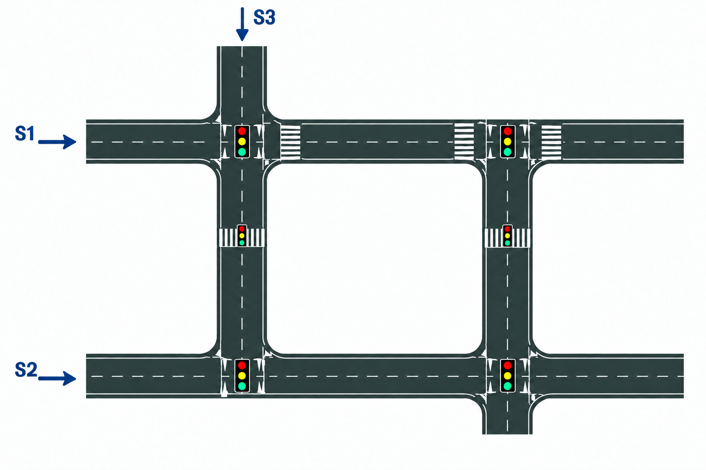

# 8b. Модель системы перекрёстков по схеме

**Задача.** Смоделировать в SimPy систему дорог и перекрёстков, изображённую на иллюстрации. Использовать модели дорожных сегментов, очередей автомобилей и управления светофорами из предыдущих упражнений.

**Условия:**

- расстояния между перекрёстками и ширины перекрёстков считать заданными; хранить их в параметрах модели;
- интенсивности входящих автомобильных потоков S1, S2 и S3 считать заданными в автомобилях в час;
- воспроизвести соединения дорог, перекрёстки и расположение светофоров согласно иллюстрации;
- скорости движения, вместимости сегментов, маршруты автомобилей и режимы светофоров задать в конфигурации эксперимента и указать при описании результатов;
- учитывать время движения по сегментам и проезда перекрёстков, ожидание разрешающего сигнала и блокирование въезда при заполнении следующего сегмента;
- если входной подход заполнен, созданный автомобиль ждёт во внешней FIFO-очереди своего источника. Генератор продолжает создавать автомобили с заданной интенсивностью;
- провести два эксперимента на одной и той же сети при одинаковых S1–S3, маршрутах, скоростях, вместимостях и последовательностях появления автомобилей. В обоих экспериментах задать одинаковую для всех светофоров длительность зелёной фазы и одинаковую длительность красной фазы;
   - **эксперимент 1. без синхронизации:** каждый перекрёсток использует собственный контроллер и независимо переключает фазы. Начальные смещения циклов задать отдельно и зафиксировать в конфигурации; 
   - **эксперимент 2. «зелёная волна»:** использовать те же длительности фаз, но согласовать моменты включения зелёного у соседних перекрёстков. Для каждого выбранного сквозного маршрута определить время движения между стоп-линиями по заданному расстоянию и допустимой скорости; сдвинуть зелёные фазы так, чтобы автомобиль, выехавший с предыдущего перекрёстка на зелёный, мог прибыть к следующему на зелёный без остановки при свободном сегменте. Указать маршруты, для которых настроена волна: из-за конфликтующих направлений беспрепятственный проезд всех маршрутов одновременно не гарантируется;
- после остановки генераторов в каждом эксперименте дождаться выхода всех созданных автомобилей, включая внешние очереди. Полное время в системе считать как `время выхода из сети` − `время появления автомобиля`. Момент появления — создание автомобиля генератором до ожидания допуска на первый сегмент; ожидание во внешней очереди входит в полное время. Среднее полное время в системе считать по всем созданным автомобилям после их выхода.

**Что реализовать:**

1. Построить граф дорожной сети по иллюстрации и создать независимые генераторы потоков S1–S3.
2. Организовать движение автомобилей по заданным маршрутам, обслуживание очередей и управление сигналами без одновременного разрешения конфликтующих движений.
3. Записывать для каждого автомобиля времена появления, допуска в сеть и выхода из неё.
4. Провести оба эксперимента с одинаковыми входными потоками и выбранными маршрутами. Сравнить среднее полное время в системе по всем автомобилям, дополнительно показав его отдельно для S1, S2 и S3 и разницу между экспериментами.

**Проверка результата.** Проверить соответствие связей сети иллюстрации, соблюдение маршрутов и вместимостей, отсутствие проезда на запрещающий сигнал и конфликтов на перекрёстках. Число созданных автомобилей должно равняться сумме вышедших и оставшихся в модели, включая ожидающих въезда. При заполненном входном сегменте проверить, что ожидание допуска во внешней очереди включено в полное время в системе. В двух экспериментах должны совпадать число созданных автомобилей и их маршруты. Без встречного трафика и заторов контрольный автомобиль на маршруте «зелёной волны», выехавший с первого перекрёстка в рассчитанный момент, проходит следующие перекрёстки без ожидания сигнала. Сравнение среднего полного времени в системе проводить после выхода всех автомобилей в обоих экспериментах.

[К обзору этапа 1](../stage-1-simpy.md)
