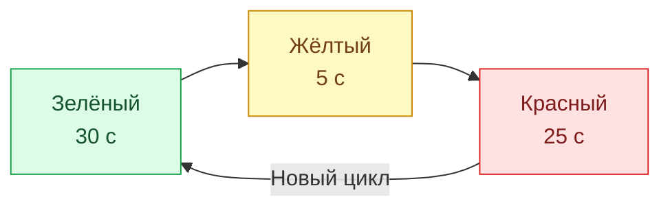
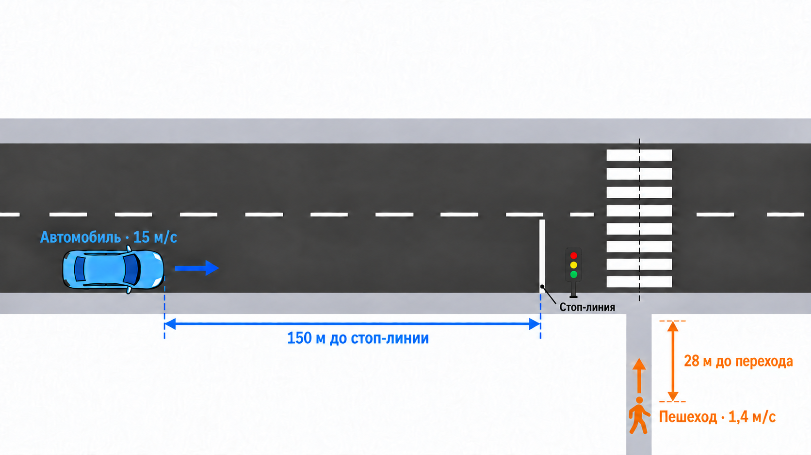
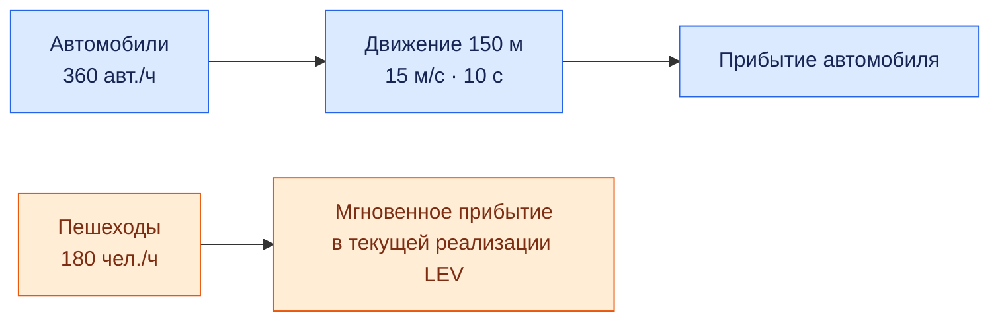
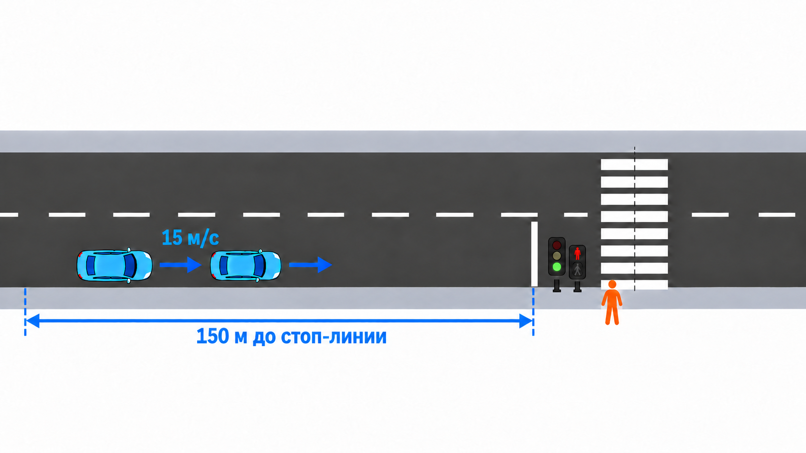
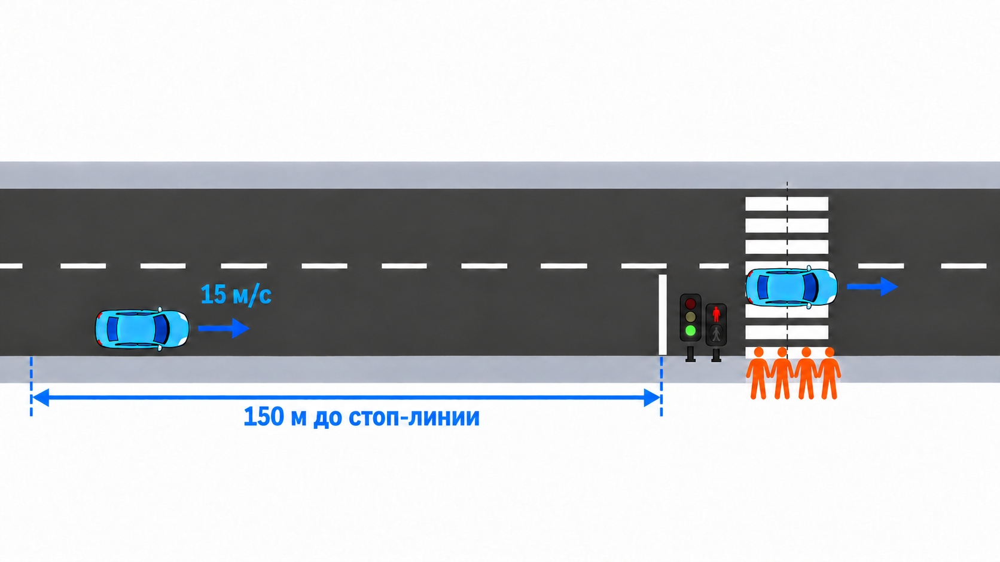
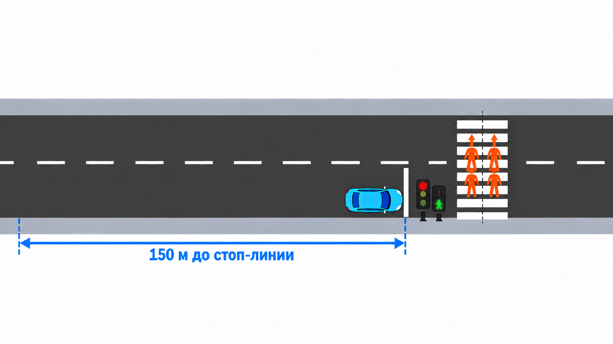
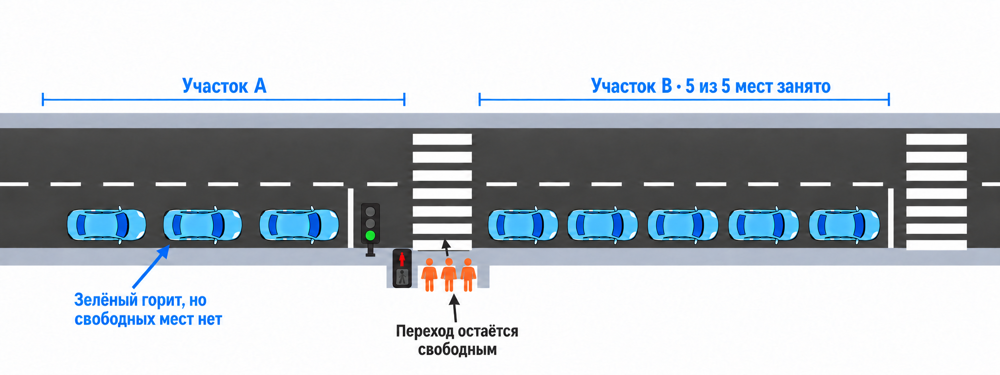
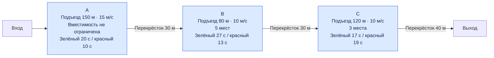
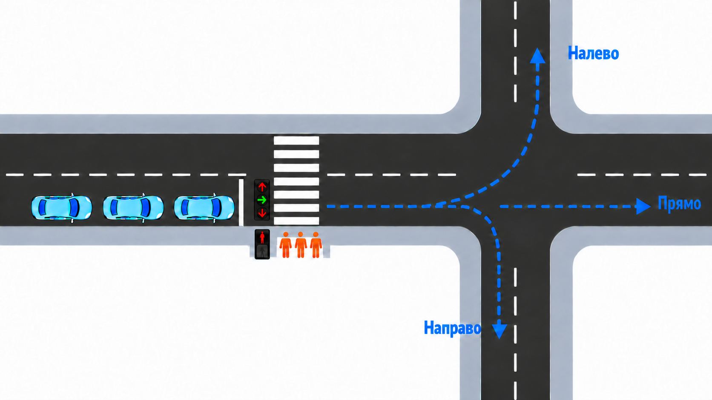

# Учебные модели SimPy: stage1_lev

Решения по [методичкам этапа 1](../openspec/stages/stage-1-simpy.md).
Время измеряется в секундах, расстояние — в метрах, скорость — в м/с.
Код `stage1-dao` используется для сравнения; импортов из него нет.

## Установка и запуск

Нужны Python 3.10+, SimPy 4.1.2 и Matplotlib. Команды выполняются из корня
`UrbanFlow`:

```powershell
py -3 -m venv .venv
& ./.venv/Scripts/python.exe -m pip install -r stage1_lev/requirements.txt

# Все задания, включая 7, с экспортом результатов:
& ./.venv/Scripts/python.exe -X utf8 -m stage1_lev --output stage1_lev/results

# Выбранное задание, воспроизводимый случайный поток и журнал:
& ./.venv/Scripts/python.exe -X utf8 -m stage1_lev --exercise 7 --seed 42 --log

# Все тесты:
& ./.venv/Scripts/python.exe -X utf8 -m unittest discover -s stage1_lev/tests -v
```

`--exercise` принимает `1`, `2`, `3`, `4`, `6`, `6a`, `7` и `all`.
Отдельный модуль запускается через новый путь, например
`python -m stage1_lev.exercises.exercise07`.

## Структура

```text
stage1_lev/
├── README.md                 # Условия, запуск, API и контрольные сценарии
├── __main__.py               # Общий CLI: выбор задания и экспорт
├── requirements.txt
├── exercises/                # Параметры и решения отдельных заданий
│   ├── exercise01.py         # Светофор 30/5/25 с
│   ├── exercise02.py         # Два параллельных процесса движения
│   ├── exercise03.py         # Случайные потоки
│   ├── exercise04.py         # Очереди у регулируемого перехода
│   ├── exercise06.py         # A → B, заполнение B
│   ├── exercise06a.py        # A → B → C, независимые светофоры
│   └── exercise07.py         # Три направления и согласованные светофоры
├── common/
│   ├── data.py              # Участники, Direction и CarArrival
│   ├── monitoring.py        # Журналы, посещения, занятость и статистика
│   ├── flows.py             # Экспоненциальные интервалы, расписания и источники
│   ├── signals.py           # Контроллеры фаз и проверка допуска
│   ├── roads.py             # SegmentConfig, IntersectionConfig и общий RoadSegment
│   ├── corridor.py          # Перекрёстки и движение по графу дорог
│   └── reporting.py         # Вывод в консоль, CSV и JSON
├── experiments.py           # График для задания 4
└── tests/
    ├── test_stage1.py        # Задания 1–3 и общий экспорт
    ├── test_crossing.py      # Задание 4
    ├── test_roads.py         # Задания 6 и 6а
    └── test_corridor.py      # Задание 7
```

Чтобы разобраться в задании, начните с соответствующего файла в `exercises`.
Упрощённая линейная модель заданий 6 и 6а находится в `exercise06a.py`:
там объявлены местный `RoadSegment`, `RoadNetwork` и общая функция `simulate`.
В задании 7 используются `RoadSegment` из `common/roads.py` и `Intersection`
из `common/corridor.py`. Настройки конкретной сети и её запуск находятся
в `exercise07.py`. `common` не зависит от модулей упражнений.
Каталоги окружения, кэша и сгенерированных результатов исключены из Git.

## Общие правила моделей

Случайные потоки по умолчанию работают до `horizon=600`, при интенсивностях
`car_rate=360` автомобилей в час и `pedestrian_rate=180` пешеходов в час.
Первое появление, как и последующие, происходит после случайного
экспоненциального интервала. Нулевая интенсивность отключает поток.

`horizon` ограничивает появление новых участников. После него модель
дожидается выхода уже созданных участников. Пустая очередь между появлениями
не завершает симуляцию. Бесконечный процесс светофора не мешает завершению.

Для заданий с очередями `car_arrivals` и `pedestrian_arrivals` заменяют
случайные потоки: `None` включает случайную генерацию, `[]` отключает её.
Времена автомобилей относятся к входу на A. `cars_at_crossing=True` помещает
их сразу к стоп-линии для контрольных сценариев.

В заданиях 4, 6 и 6а фиксированные расписания могут содержать появления за
пределами `horizon`. В задании 7 оба вида расписаний, как и случайные потоки,
ограничены условием `t < horizon`.

Во всех моделях с переходом автомобиль должен успеть закончить текущий
проезд до конца своего зелёного. Завершение ровно на границе разрешено.
Контроллер хранит текущую фазу и время её окончания; проверка допуска
использует эти данные. Остаток времени не вычисляется через `%`, поэтому
дробная длительность зелёного не заставляет автомобиль пропускать циклы.

Пешеходы в заданиях 4–7 появляются непосредственно у перехода. В начале
своей фазы переходят все, кто прибыл строго раньше её начала. Прибывшие
ровно на границе или позже ждут следующую группу. Переход занимает 5 с.

## Задания 1–4

| Задание | Поведение и контрольный результат |
| --- | --- |
| [1](../openspec/stages/stage-1-simpy/exercise-01.md) | Светофор: 30 с зелёный, 5 с жёлтый, 25 с красный. За `[0, 180)` девять переключений; событие в 180 с исключено. |
| [2](../openspec/stages/stage-1-simpy/exercise-02.md) | Общий старт в 0 с. Автомобиль проходит 150 м при 15 м/с за 10 с, пешеход — 28 м при 1.4 м/с за 20 с. |
| [3](../openspec/stages/stage-1-simpy/exercise-03.md) | Независимые случайные потоки. Сохранена прежняя реализация: автомобиль движется 10 с, пешеход прибывает мгновенно. |
| [4](../openspec/stages/stage-1-simpy/exercise-04.md) | Автомобили: 10 с подъезда, FIFO-очередь и 2 с проезда. Светофор: 20 с автомобилям, затем 10 с пешеходам. |

### Задание 1: цикл светофора



Один цикл занимает 60 с. Модель начинает с зелёного и повторяет цикл трижды.

### Задание 2: независимое движение



*Иллюстрация из методички: автомобиль достигает стоп-линии за 10 с,
пешеход подходит к переходу за 20 с. Ожидание сигнала здесь ещё не моделируется.*

### Задание 3: случайные потоки



**Известное расхождение задания 3:** актуальная методичка требует 20 с
движения пешехода по тротуару. Его реализация и тесты пока соответствуют
прежнему условию с мгновенным прибытием.

### Задание 4: очередь и пешеходная группа



*Автомобильный интервал: машины могут проезжать, пешеходы ждут.*



*К началу пешеходной фазы у перехода накапливается группа.*



*Пешеходный интервал: ожидавшая группа переходит за 5 с, автомобили стоят.
Иллюстрации взяты из методички задания 4.*

Контрольный запуск задания 4:

```powershell
& ./.venv/Scripts/python.exe -X utf8 -m stage1_lev --exercise 4 --demo --log
```

Три автомобиля у стоп-линии в 0 с проходят в 0–2, 2–4 и 4–6 с.
Два пешехода, появившиеся в 1 с, переходят в 20–25 с.
При очереди из 12 автомобилей первые 10 проходят в 0–20 с, оставшиеся —
в 30–32 и 32–34 с.

График среднего времени автомобиля при разных интенсивностях пешеходов:

```powershell
& ./.venv/Scripts/python.exe -X utf8 -m stage1_lev.experiments
```

Один автомобильный поток используется для всех точек графика. При фиксированном
цикле число пешеходов не меняет автомобильные фазы, поэтому график горизонтальный.
CSV, PNG и SVG сохраняются в `stage1_lev/results/experiments`.

## Задание 6: заполненный B

[Условие](../openspec/stages/stage-1-simpy/exercise-06.md).
Вместимость A не ограничена. На B пять мест, включая резервы машин,
которые ещё проезжают переход A. Машина резервирует место до начала проезда,
затем полностью въезжает на B, движется 10 с и покидает сеть.
При закрытом выходе остаётся на B и продолжает занимать место.



*Иллюстрация из методички: заполненный B блокирует выпуск с A.
Машины ждут перед переходом и не мешают пешеходам.*

```powershell
# Восемь автомобилей у A, выход B закрыт до 60 с:
& ./.venv/Scripts/python.exe -X utf8 -m stage1_lev --exercise 6 --demo --log

# Одинаковые входные потоки: открытый и временно закрытый выход B:
& ./.venv/Scripts/python.exe -X utf8 -m stage1_lev --exercise 6 --compare --output stage1_lev/results
```

В демонстрации начала проезда A: 0, 2, 4, 6, 8, 60, 62 и 64 с.
Последний автомобиль покидает B в 76 с. Пешеходы переходят в 20–25 с.
Параметр `exit_open_at` задаёт время открытия выхода B.

## Задание 6а: A → B → C

[Условие](../openspec/stages/stage-1-simpy/exercise-06a.md).
Одна модель участка обслуживает весь маршрут:

| Участок | Подъезд / перекрёсток, м | Скорость, м/с | Вместимость | Зелёный / красный, с |
| --- | --- | --- | --- | --- |
| A | 150 / 30 | 15 | Не ограничена | 20 / 10 |
| B | 80 / 30 | 10 | 5 | 27 / 13 |
| C | 120 / 40 | 10 | 3 | 17 / 19 |



*Автомобиль проходит A → B → C. Перед каждым перекрёстком своя очередь;
заполнение C задерживает выпуск с B, а заполнение B — выпуск с A.*

Все светофоры начинают с зелёного в 0 с и переключаются в собственных процессах.
У каждого перехода своя пешеходная очередь и случайный поток. Машина занимает
исходный участок до конца его перекрёстка и одновременно резервирует место
на следующем. Если во время ожидания разрешение потеряно, заявка отменяется,
а уже полученное место возвращается.

```powershell
# Один автомобиль со входом на A в 0 с:
& ./.venv/Scripts/python.exe -X utf8 -m stage1_lev --exercise 6a --demo --log

# Девять автомобилей у A, запрет начала проезда C до 180 с:
& ./.venv/Scripts/python.exe -X utf8 -m stage1_lev --exercise 6a --spillback --log
```

Один автомобиль прибывает к стоп-линиям A/B/C в 10, 20 и 35 с,
проезжает перекрёстки в 10–12, 20–23 и 36–40 с. Выход из сети — в 40 с.
В сценарии затора последний из девяти автомобилей выходит в 264 с.
Запрет проезда C не останавливает его светофор и местных пешеходов.

`run` принимает `segments` с объектами `SegmentConfig`,
`crossing_closed_until={"C": 180}` и `observe_until` для продолжения наблюдения
за сигналами после выхода участников. `pedestrian_arrivals` задаётся по участкам:
`{}` отключает всех пешеходов, `{"A": None, "B": [], "C": None}` включает
случайные потоки только у A и C. Пропущенное имя в заданном словаре отключает поток.

## Задание 7: три направления и согласованные светофоры

[Условие](../openspec/stages/stage-1-simpy/exercise-07.md).
При входе на каждый перекрёсток автомобиль выбирает местное направление.
На A вероятности равны 0.5 для движения прямо, 0.3 для левого поворота и 0.2
для правого. После 10 с движения по A он встаёт в отдельную FIFO-очередь своего
направления. Затор на одной полосе не перекрывает другие. На принимающих
перекрёстках базового сценария доступно только движение прямо.



*Иллюстрация направлений из методички задания 7. В реализации каждому
направлению соответствует отдельная очередь на A и принимающий участок B_T, B_L или B_R.*

Общий контроллер центра повторяет 60-секундный цикл:

| Интервал внутри цикла | Разрешённое движение |
| --- | --- |
| 0–24 с | Прямо |
| 24–36 с | Налево |
| 36–48 с | Направо |
| 48–60 с | Пешеходы |

Центральный перекрёсток автомобиль проезжает за 2 с. Далее движется 10 с
до следующей стоп-линии, проезжает её за 2 с и выходит из сети.
Принимающие светофоры используют то же начало цикла 0 с:

| Направление | Подход | Вместимость | Местный зелёный |
| --- | --- | --- | --- |
| Прямо (`straight`) | B_T | 5 | 12–36 с |
| Налево (`left`) | B_L | 3 | 36–48 с |
| Направо (`right`) | B_R | 2 | 48–60 с |

Объект `Intersection` объединяет входной `RoadSegment`, контроллер и ссылки
на следующие перекрёстки. На A три очереди `Store`, на каждом принимающем
участке — собственные очередь, процесс обслуживания и `Container` свободных мест.
Все процессы обслуживания запускаются сразу, включая обслуживание исходных машин на B_L.

`IntersectionConfig` задаёт входной `SegmentConfig`, длительности фаз
(`phases_duration`), соответствие полос фазам (`car_phases`), вероятности
поворотов, время перехода пешеходов и конфигурации следующих перекрёстков
(`outgoing`). Базовая сеть целиком описана объектом `exercise07.CONFIG`.
Свою конфигурацию можно передать в `exercise07.run(config=...)`.
Вероятность движения прямо равна `1 - (left_probability + right_probability)`.

Имена дорог используются как идентификаторы в журнале и настройках запретов.
Они не определяют число полос или правила сбора статистики: проверка вроде
`name == "A"` меняла бы поведение при переименовании дороги и мешала бы добавить
второй перекрёсток с тремя направлениями. Полосы берутся из конфигурации,
а общие времена очереди фиксируют первое ожидание участника на маршруте.

Место принимающего участка резервируется перед началом проезда A и освобождается
только после полного проезда принимающего перекрёстка. Красный у принимающего
светофора не мешает въезду на его участок, пока там есть место.
После ожидания места заново проверяются фаза и остаток зелёного в центре.
Неисполненная заявка отменяется, полученный при потере разрешения резерв возвращается.

В обоих местах проезд должен закончиться до конца зелёного. Это правило
методички; старый тест DAO, разрешающий проезд после смены фазы, не воспроизводится.

```powershell
# По одному автомобилю каждого направления у центральной стоп-линии:
& ./.venv/Scripts/python.exe -X utf8 -m stage1_lev --exercise 7 --demo --log

# B_L занят тремя исходными машинами; выпуск запрещён до 120 с:
& ./.venv/Scripts/python.exe -X utf8 -m stage1_lev --exercise 7 --spillback --log

# Случайный поток и CSV/JSON:
& ./.venv/Scripts/python.exe -X utf8 -m stage1_lev --exercise 7 --seed 42 --output stage1_lev/results

# Только проверки задания 7:
& ./.venv/Scripts/python.exe -X utf8 -m unittest stage1_lev.tests.test_corridor -v
```

Контрольные времена для пустых принимающих участков:

| Направление | Проезд A | Следующая стоп-линия | Проезд принимающего перекрёстка |
| --- | --- | --- | --- |
| Прямо | 0–2 с | 12 с | 12–14 с |
| Налево | 24–26 с | 36 с | 36–38 с |
| Направо | 36–38 с | 48 с | 48–50 с |

При заполненном B_L исходные машины проезжают его в 156–158, 158–160 и
160–162 с. Входящий левый поворот ждёт до 204 с. Машины прямо и направо
проходят по прежнему расписанию. Исходные машины имеют `is_initial=True`;
они учитываются отдельно от сгенерированных и входят в общее число завершивших путь.

Для своих расписаний:

```python
from stage1_lev.exercises import exercise07
from stage1_lev.common.reporting import display

result = exercise07.run(
    car_arrivals=[
        exercise07.CarArrival(0, exercise07.Direction.STRAIGHT),
        exercise07.CarArrival(0, exercise07.Direction.LEFT),
        exercise07.CarArrival(0, exercise07.Direction.RIGHT),
    ],
    pedestrian_arrivals=[1, 48],
    cars_at_crossing=True,
    prefilled_left_count=3,
    left_release_blocked_until=120,
)
display(result, show_log=True)
```

`CarArrival` требует константу `Direction.STRAIGHT`, `Direction.LEFT` или
`Direction.RIGHT`; преобразования строк в конструкторе нет. `__post_init__`
проверяет время появления и тип направления. Пешеход в 1 с
переходит в 48–53 с, пришедший ровно в 48 с — в 108–113 с.
Потоки автомобилей, пешеходов и выбор направления используют отдельные
`Random(seed)`, `Random(seed + 1)` и `Random(seed + 2)` для центрального перекрёстка.
У следующих перекрёстков свои RNG. Выбранное направление при заторе не меняется;
новый выбор происходит при въезде на следующий перекрёсток.
В `summary()` доступны `directions` с числами созданных, исходных,
сгенерированных и завершивших путь машин, а также `completed_by_direction`.
Эти счётчики группируют машины по первому направлению (`entry_direction`).

## Результаты и проверки

Каждый `run` возвращает журнал с `participants`, `events`, `finished_at`
и `summary()`. Экспорт создаёт подкаталог задания: `exercise01`, `exercise02`,
`exercise03`, `exercise04`, `exercise06`, `exercise6a` или `exercise07`.
Повторный экспорт перезаписывает файлы выбранного задания.

| Файл | Содержимое |
| --- | --- |
| `events.csv` | Появления, очереди, проезд, выход и переключения сигналов |
| `participants.csv` | Участники и общие времена; в 7 также `direction`, `entry_direction` и `is_initial` |
| `summary.json` | Числа участников, средние времена; для 6–7 также параметры и итоговое состояние участков |
| `visits.csv` | В 6–7: отдельная запись каждого автомобиля на каждом участке |
| `monitoring.csv` | В 6–7: занятые, зарезервированные, свободные места и длины очередей |

CSV записывается в UTF-8 с BOM без округления времён. Ссылки на текущий
и зарезервированный участки не сериализуются.

`arrived_at` — время полного выхода участника из модели; `travel_time` —
разница между выходом и появлением. В 6–7 поля `queue_entered_at` и
`queue_left_at` участника относятся к его первой очереди, а `queue_wait_total` и
`mean_queue_wait` включают ожидание по всему маршруту. Для исходных машин B_L
первой является очередь B_L. Свойство `queue_wait` возвращает накопленное
ожидание для расчёта среднего в `CrossingResult.summary()`.

`local_segment` хранит место появления местного пешехода. Оно остаётся
доступным после выхода, когда `current_segment` уже сброшен, и позволяет
сопоставить пешехода с расписанием его перехода.

В задании 7 `direction` участника хранит последний выбранный поворот,
а `entry_direction` — первый (для исходных машин B_L это левое направление
входного потока). `visits.csv` хранит местный `direction` каждого посещения
и время резервирования `reserved_at`.
`capacity_wait` измеряет ожидание заявки на место до её исполнения или смены
центральной фазы и входит в общее ожидание. `monitoring.csv` содержит отдельные
`straight_queue_len`, `left_queue_len`, `right_queue_len` на каждом участке.
После завершения модели очереди и резервы пусты, а свободные места B_T/B_L/B_R
полностью восстановлены до 5/3/2.

Тесты проверяют контрольные времена методичек, FIFO, границы зелёного,
группы пешеходов, воспроизводимость и независимость случайных потоков.
Для задания 7 вместимость дополнительно проверяется по интервалам
резервирования и выхода отдельных машин, независимо от значений мониторинга.
Частоты направлений проверяются на потоке за 36 000 с.
